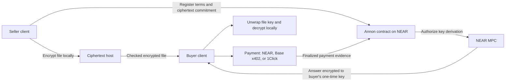

<p align="center">
  <picture>
    <source media="(prefers-color-scheme: dark)" srcset="docs/assets/annon-mark-dark.svg">
    
  </picture>
</p>

<h1 align="center">Annon</h1>

<p align="center"><b>Pay, friend, and enter.</b><br>
Annon lets people and agents sell client-encrypted files, with payment verification and key release
coordinated on NEAR.</p>

<p align="center">
  <a href="https://annon.dev/demo">Demo</a> ·
  <a href="#quick-start">Quick start</a> ·
  <a href="#documentation-for-people-and-agents">Docs</a> ·
  <a href="specs/">Specification</a> ·
  <a href="SECURITY.md">Security</a> ·
  <a href="https://annon.dev">annon.dev</a>
</p>

---

## What it is

Selling a digital file usually means trusting a platform. The platform stores the file, holds the
buyer's money and decides who gets the download link. If it disappears, changes its rules or leaks
the file, the seller and the buyer have no recourse.

Annon is an open protocol, SDK, CLI and MCP server that removes that middle role:

- The seller encrypts the file on their own machine and registers its terms on a NEAR contract: the
  price, who is paid and in what shares, and a commitment to the encrypted file. The encrypted file
  can be hosted anywhere. The host cannot read it.
- The buyer pays in USDC on NEAR, on Base through [x402](https://x402.org), or from a supported
  source chain through NEAR Intents (1Click). The contract checks the payment on chain, Base
  included.
- NEAR's MPC network then derives the secret that unlocks the file key and encrypts it to a one-time
  key that only the buyer holds. The buyer decrypts locally. No host, relayer or shop sees the file
  key.
- The money follows the registered split. If the buyer moves to another device, the same wallet gets
  the file again without paying twice.

People and agents buy the same way: an Annon file is an ordinary URL that answers HTTP `402` with its
offers.

**Status: alpha.** The contract runs on NEAR mainnet, can still be upgraded by defdone and has no
independent audit yet. See [Encryption and trust](#encryption-and-trust).

## Why we built it

We are not aware of another open file-selling protocol that combines NEAR MPC key release, NEAR
Intents 1Click payments and client-side file encryption. We built Annon to make that combination
usable by people, shops and agents.

We wanted three things at once. The file should be encrypted before any server sees it. The key
should be released by a contract that checked the payment itself, not by a server that says it did.
And an agent should be able to buy a file with the same URL a person opens, under limits its owner
sets.

## What it can become

Annon is small today: one contract, one SDK, a demo shop. These follow from how it already works:

- **Files that are not tied to one shop.** The terms live on NEAR. The same encrypted file can be
  served by any host that implements the download protocol, and shops describe themselves in a
  manifest at `/.well-known/annon-shop.json`, so clients and agents can find them. Wherever the file
  is sold, the registered split decides who gets paid.
- **Agents that pay for data.** An agent buys a file the way it would call a paid API: through an
  HTTP 402 offer, with a price cap and a daily budget. It can also sell its own output, such as a
  report or a dataset, with the same tools.
- **Payouts to collaborators.** A file pays up to eight recipients in fixed shares. NEAR payments
  are credited to NEAR Intents accounts, from which recipients can withdraw to other chains.
- **Access without accounts.** There is no shop login. The buyer's wallet is the proof of purchase,
  on any device and in any client that speaks the protocol.

What we plan next is in [ROADMAP.md](ROADMAP.md).

## How it works



Three payment routes, named the same in the SDK, the CLI and the MCP server:

| Route | The buyer pays with | Where the money goes |
|---|---|---|
| `near` | USDC on NEAR, from a NEAR account | The contract holds it until anyone calls `settle`, which credits every recipient's NEAR Intents account |
| `base` | USDC on Base, through x402 | Straight to the file's split contract on Base ([0xSplits](https://splits.org)), which pays the same shares |
| `1click` | A supported token on another chain, swapped by NEAR Intents into USDC on NEAR | As for `near` |

Not every payment passes through NEAR. A Base payment stays on Base; the contract only verifies it,
by asking the MPC network to check the Base transaction (`verify_foreign_transaction`) instead of
trusting a relayer or an oracle. Direct `base` payments need a Base payee in the file's on-chain
terms. Files from EVM sellers can have one. Files from NEAR and Solana sellers do not, and a buyer
with USDC on Base pays those through `1click` with Base as the source chain.

What NEAR does, step by step:

| Step | On NEAR |
|---|---|
| Listing | The contract stores the terms, signed by the seller, and a commitment that covers the hash of every encrypted chunk. |
| Payment on NEAR | USDC arrives through `ft_transfer_call`; the contract checks the amount against the terms. |
| Payment on Base | The contract asks the MPC network to verify the Base transaction. |
| Payment from another chain | NEAR Intents (1Click) swaps and delivers USDC to the contract, which accepts it like a direct payment. |
| Key release | The MPC network runs confidential key derivation (CKD) for the buyer's one-time key. Only that key can read the answer. |
| Payout | For payments received on NEAR, anyone can call `settle`. Underpayments are refunded in full; overpayments are accepted and the excess is refunded. |
| Recovery | The buyer's wallet signs for a new one-time key on a new device. No second payment. |

## Encryption and trust

How a file is protected:

- The seller's client creates a random 32-byte file key. The PAY2 format derives one key per chunk
  from it and encrypts each chunk with AES-256-GCM. The registered commitment binds the whole
  encrypted body, so a buyer can check every byte against the registration.
- The file key is wrapped with a secret that only NEAR MPC confidential key derivation produces for
  this contract and file.
- After the contract accepts a payment, the buyer receives an MPC answer encrypted for their
  one-time key. The buyer's client unwraps the file key and decrypts locally.

What this rests on:

- The cryptography is correct, and the seller's and buyer's clients are not compromised.
- The NEAR MPC network's threshold security holds, and the contract requests keys only under its
  access rules.
- During the alpha defdone can upgrade the contract. That is the largest trust we ask for. There is
  no independent audit yet. We plan one, then we remove the upgrade key and lock the contract.

What it does not do:

- **It is not DRM.** The seller knows the content, and a buyer can share what they decrypted.
- Listing terms, titles, descriptions and file sizes are public. Only the content is encrypted.
- Encryption and key release do not prove the content is useful, and do not keep a host online.
  Keep your own copy of what you buy.
- A preview inside a PAY2 file is not checked for buyers in this release.

The full trust model and the known limits are in [SECURITY.md](SECURITY.md). The formats are in
[specs/pay2.md](specs/pay2.md) and [specs/near-settlement.md](specs/near-settlement.md).

## Quick start

### Try it in a browser

A shop can build a browser purchase screen on the SDK. The SDK supports the file's available payment
routes, local decryption and saved purchase records. The demo shop is at
**[annon.dev/demo](https://annon.dev/demo)**.

You pay with your own funds. On Base you need only USDC, no ETH: you sign an authorization and the
host pays the gas. On NEAR you also need a little NEAR for gas. Through 1Click you fund the quoted
amount of the source token plus that chain's gas; the quote includes the swap fees. The demo's
open pool allows up to 10 upload admissions and 2 sponsored listings per wallet and per IP bucket per
UTC day. Listed sellers have a separate allowance of 20 per wallet per day. Hosted files normally
expire seven days after publication; keep your own copy. All limits:
[docs/shops-and-limits.md](docs/shops-and-limits.md). Questions, or a file to report: hello@annon.dev.

### Buy a file

You need Node.js 22.18 or newer, and either a NEAR wallet with a little USDC and NEAR, or an EVM
wallet with USDC on Base. Install the CLI. The alpha packages are pending publication. Once
published, install them with the npm `alpha` tag. Until then, build from source as in
[Build and test](#build-and-test) and use the built CLI.

```sh
npm install -g @defdone/annon@alpha
```

Write `~/.config/annon/config.json` with the deployment and your price cap, create a backup secret,
and sign in with your wallet: [docs/quickstart.md](docs/quickstart.md) has each command. Then:

```sh
annon verify https://demo.annon.dev/f/what-we-are-building --trust-contract
annon buy https://demo.annon.dev/f/what-we-are-building --route near
annon status 0xPURCHASE_ID
annon open 0xPURCHASE_ID --output what-we-are-building.pdf
```

You see the price and the recipients before you approve. Then you get a purchase ID, a status of
`accepted`, and the decrypted file. If `status` says `pending`, wait and ask again; never pay a
second time for the same purchase. For a file without Base terms, `--route base` stops with
`route_unavailable` before any payment; use `--route 1click --from-chain base` instead. Opening the
file on another computer: [docs/quickstart.md](docs/quickstart.md#5-open-it-on-another-computer).

### Sell a file

The simplest path is hosted selling through a shop, with a NEAR, EVM or Solana wallet. Add the shop,
approve its deployment profile in your configuration ([docs/selling.md](docs/selling.md)), then:

```sh
annon shop add https://shop.example --id SHOP_ID
annon share report.pdf --price 1.00 --shop SHOP_ID --title "Q3 report"
```

The CLI encrypts the file locally and shows the final terms: the price, the split with any fee share,
and for a NEAR seller the storage it pays. After you type `yes` it saves a backup, uploads the
encrypted file to the shop's host, registers the terms and prints the purchase URL with the hosting
expiry. EVM and Solana sellers need no NEAR: the shop's relayer pays and takes its fee share. If the
shop publishes rules in its manifest, the CLI prints them with the result. If a sale stops, resume it
with `annon share report.pdf --resume 0xFILE_ID --shop SHOP_ID`; never start a new one.

To host the file yourself, `annon sell` writes a `.pay2` file and registers its terms. You serve the
file from a server built on the SDK's `serveFile` ([apps/demo-host](apps/demo-host) is a complete
example). A NEAR account pays its own storage and gas, and no protocol fee is added:

```sh
annon sell report.pdf --wallet near --price 1.00 --split near:YOUR_ACCOUNT.near:10000 --storage-budget 0.05 --output report.pay2
```

Splits are in basis points, total 10000, and pay up to eight recipients. Routes, storage, splits and
resuming: [docs/selling.md](docs/selling.md).

### Run an agent with MCP

```json
{
  "mcpServers": {
    "annon": {
      "command": "npx",
      "args": ["-y", "@defdone/annon-mcp@alpha"],
      "env": {
        "ANNON_CONFIG": "/absolute/annon-agent.json",
        "ANNON_BACKUP_SECRET_FILE": "/absolute/private/backup-secret"
      }
    }
  }
}
```

The owner writes the configuration file it points to: the trusted contract, `maxPrice` per purchase, `dailyBudget` per
UTC day, the `workDir` the agent may use, and the wallet. The agent's key stays in a file, an
environment variable, the macOS Keychain or a remote signer. Tools never see it and cannot change any
limit. The agent runs `annon_catalog` or `annon_verify`, then `annon_buy`, then `annon_status` until
`accepted`, then `annon_open`. The result is a structured status and the decrypted file inside
`workDir`. Discovery tools are read-only and cannot approve a deployment or a payment. An agent can
also sell with `annon_share` or `annon_sell`, under the same owner policy. Full setup:
[docs/agents.md](docs/agents.md).

## For developers

```ts
import { Annon } from '@defdone/annon';
import {
  BrowserPurchaseController,
  browserEvmWallet,
  browserPurchaseStorage,
} from '@defdone/annon/browser';
```

The SDK runs in Node.js and in browsers. The browser entry has a purchase controller that survives
reloads and works across tabs, encrypted local receipts, downloads with in-browser decryption, a
seller controller for hosted selling from a page (`createBrowserSeller`), and adapters for injected
EVM, Solana and NEAR wallets. There is no hosted checkout: a shop builds its
own screen on the SDK. To run a shop, see [apps/demo-host](apps/demo-host),
[apps/relayer](apps/relayer) and [docs/shops-and-limits.md](docs/shops-and-limits.md). SDK
reference: [packages/annon](packages/annon).

## Documentation for people and agents

Every document is plain Markdown, so an agent can read it directly.

| Document | Covers |
|---|---|
| [annon.dev/llms.txt](https://annon.dev/llms.txt) | Index of the public docs, for agents |
| [docs/quickstart.md](docs/quickstart.md) | Install, configure, buy, open, recover |
| [docs/selling.md](docs/selling.md) | Hosted and self-hosted selling, routes, splits |
| [docs/agents.md](docs/agents.md) | MCP setup, owner limits, the tool sequence |
| [docs/shops-and-limits.md](docs/shops-and-limits.md) | Fees, shop limits, shop rules |
| [docs/near-accounts.md](docs/near-accounts.md) | NEAR storage costs for sellers and recovery |
| [docs/what-can-go-wrong.md](docs/what-can-go-wrong.md) | Errors, retries, refunds and other failure cases |
| [packages/annon/CLI.md](packages/annon/CLI.md) | Every CLI command and option |
| [packages/annon-mcp](packages/annon-mcp/README.md) | MCP tools, configuration, safety model |
| [skills/annon/SKILL.md](skills/annon/SKILL.md) | Agent skill: the whole flow, when to wait |
| [SECURITY.md](SECURITY.md) | Trust model, known limits, reporting |

Specifications, with test vectors checked in CI, so anyone can build a compatible implementation:

| Document | Defines |
|---|---|
| [specs/pay2.md](specs/pay2.md) | PAY2, the encrypted file format |
| [specs/near-settlement.md](specs/near-settlement.md) | Listing, purchase, routes, key release, payouts, refunds |
| [specs/x402-annon.md](specs/x402-annon.md) | The x402 offer and the Base payment |
| [specs/download.md](specs/download.md) | Serving the file to the buyer who proves the purchase |
| [specs/nonce.md](specs/nonce.md) | Purchase and payment nonces |
| [specs/vectors/](specs/vectors) | Test vectors |

## Build and test

You need Node.js 22.18 or newer, pnpm 12 (`corepack enable` picks the pinned version) and Rust from
`rust-toolchain.toml`. From the repository root:

```sh
pnpm install --frozen-lockfile
pnpm build
pnpm test
contracts/annon/build.sh
cargo test
```

These run locally and send no transactions. `build.sh` builds the contract's wasm, which the sandbox
tests use. CI runs the same steps, plus formatting, lint, a dependency audit, the spec-vector check
and container tests of the relayer and the demo host.

| Path | Contents |
|---|---|
| [contracts/annon](contracts/annon) | The NEAR contract (Rust, near-sdk) |
| [packages/annon](packages/annon) | `@defdone/annon`: SDK and `annon` CLI |
| [packages/annon-mcp](packages/annon-mcp) | `@defdone/annon-mcp`: local MCP server |
| [apps/relayer](apps/relayer) | Relayer: sponsors NEAR transactions and runs the settlement keeper |
| [apps/demo-host](apps/demo-host) | File host with hosted uploads and its own x402 facilitator on Base |
| [specs](specs) | Specifications and test vectors |
| [skills/annon](skills/annon) | Agent skill |

## Project status

| | |
|---|---|
| Stage | Alpha, on NEAR mainnet |
| Payment routes | 3: `near`, `base`, `1click`, as each file's terms allow |
| Direct payment chains | 2: NEAR and Base. Other source chains through 1Click, as its routes and liquidity allow |
| Wallets | NEAR, EVM and Solana, for sellers and buyers |
| File size | Up to 50,000,000 bytes of plaintext per file |
| Split recipients | Up to 8 |
| Tests | About 2,600 automated JavaScript tests in CI, plus the contract's Rust unit and sandbox tests |
| Fees | None for the protocol, SDK, CLI or MCP server on your own infrastructure ([details](docs/shops-and-limits.md#fees)) |

| Deployment | Mainnet |
|---|---|
| Contract | [`v1.annon.defdone.near`](https://nearblocks.io/address/v1.annon.defdone.near) |
| Relayer | `https://relayer.mainnet.annon.dev` |
| Demo shop | `https://annon.dev/demo` |
| Demo files | `https://demo.annon.dev` |
| MPC network | `v1.signer` |
| USDC | NEAR native USDC and Base USDC |

To report a vulnerability, use GitHub's private reporting on this repository
([SECURITY.md](SECURITY.md)).

## Built at NEAR HACKATHON

All code in this repository was written during the hackathon, starting on 2 November 2026. The
`pre-hackathon` tag marks the initial commit: license, README and ignore rules, no application code.
We tag the submitted commit `hackathon-submission`, and
[this comparison](https://github.com/defdone/annon/compare/pre-hackathon...hackathon-submission)
shows everything built in between.

The team is defdone. Before the hackathon we built Payaion, a closed file-selling app on Base, and
the PAY1 file format that PAY2 extends. No Payaion code is in this repository; Payaion will be the
first app to adopt Annon.

**Libraries.** The SDK uses [@noble/curves](https://github.com/paulmillr/noble-curves),
[@noble/hashes](https://github.com/paulmillr/noble-hashes), [@scure/base](https://github.com/paulmillr/scure-base),
[near-api-js](https://github.com/near/near-api-js) and [viem](https://viem.sh); the CLI's browser
login bundles [NEAR Wallet Selector](https://github.com/near/wallet-selector). The MCP server uses
the official [MCP TypeScript SDK](https://github.com/modelcontextprotocol/typescript-sdk) and
[zod](https://zod.dev). The contract uses [near-sdk](https://github.com/near/near-sdk-rs) and the
interface crates of [near/mpc](https://github.com/near/mpc). Payments use
[0xSplits](https://splits.org) contracts on Base and the [1Click API](https://docs.near-intents.org)
of NEAR Intents. Tooling: TypeScript, Vitest, Biome, esbuild and Changesets.

**AI assistance.** I wrote Annon with AI coding assistants, Claude Code and Codex, for
implementation, reviews and tests. Changes are reviewed and tested in CI. Manual mainnet tests of the
payment paths with small amounts of real USDC are part of the release checklist.

## License

[Apache-2.0](LICENSE). Created by [defdone](https://defdone.com).
